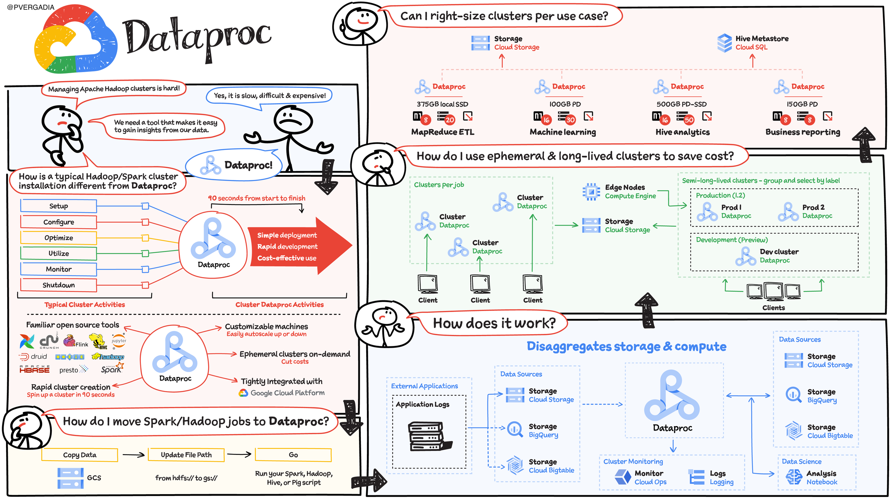

# Chapter 01 — Introduction to Google Cloud Dataproc & Apache Spark

## Overview

In this chapter, we introduce **Apache Spark** and **Google Cloud Dataproc**, explaining why separating compute from storage (**Cloud Storage** & **BigQuery**) allows modern data engineering teams to replace expensive, permanent Hadoop/HDFS clusters with fast, ephemeral, job-scoped Spark clusters.

### What You Will Learn
1. **The Evolution from On-Premises Hadoop to Cloud Dataproc**: Why colocation of HDFS storage and YARN compute created scaling bottlenecks.
2. **Cloud-Native Spark Architecture**: Reading raw files directly from **Cloud Storage (`gs://`)** using the GCS Connector and writing curated tables to **BigQuery** via the Spark BigQuery Storage API.
3. **Dataproc Deployment Flavors**: Dataproc on Compute Engine vs. Dataproc on GKE vs. **Dataproc Serverless** (*now labeled **Managed Apache Spark / Google Cloud Serverless for Apache Spark** in the Google Cloud Console*).

> **Google Cloud Console Naming Note**: In the Google Cloud Console and BigQuery Studio, **Dataproc** now appears as **Managed Apache Spark** (and **Dataproc Serverless** as **Google Cloud Serverless for Apache Spark**). The underlying API (`dataproc.googleapis.com`) and CLI (`gcloud dataproc`) keep the `dataproc` name.

---

## Chapter Contents

| File | Description |
| :--- | :--- |
| [`01_dataproc_introduction.ipynb`](./01_dataproc_introduction.ipynb) | Interactive notebook covering Spark architecture, Dataproc benefits, and storage connectors. |

---

## Architecture Diagram

