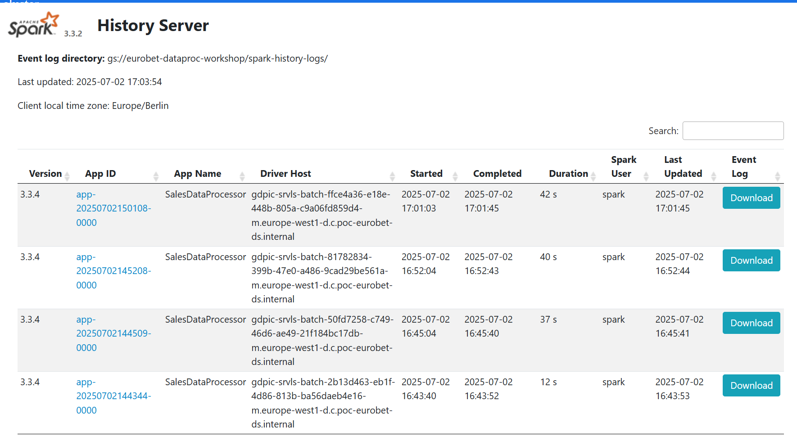
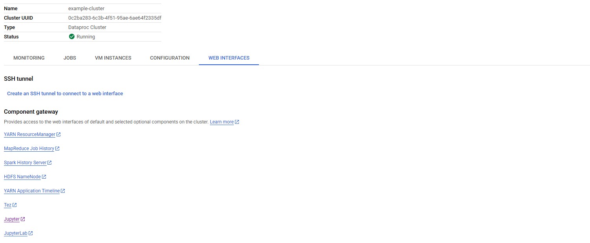

# Chapter 04 — Dataproc Serverless for Spark (Zero-Ops BigQuery ETL)

## Overview

In Chapters 02 and 03, you provisioned and managed a Compute Engine Dataproc cluster before submitting your PySpark job. With **Dataproc Serverless for Spark**, you no longer provision, tune, or tear down clusters—you simply submit your PySpark batch script (`gcloud dataproc batches submit pyspark`), and Google Cloud dynamically allocates and autoscales the executors for the exact duration of the job.

### What We Are Going to Do
1. **Examine the Serverless PySpark ETL Script ([`spark_apps/serverless_bq_etl.py`](./spark_apps/serverless_bq_etl.py))**:
   * Uses the built-in Spark BigQuery connector included in Dataproc Serverless Runtime `1.1`/`2.2`.
   * Reads `sales_data` from BigQuery, aggregates daily product revenue for `--processing-date`, and writes `filtered_sales` back to BigQuery.
2. **Submit a Serverless Batch via CLI ([`scripts/01_submit_serverless_batch.sh`](./scripts/01_submit_serverless_batch.sh))**:
   * Uploads `serverless_bq_etl.py` to Cloud Storage and invokes `gcloud dataproc batches submit pyspark`.

> **Bridge to Part 2 ([`composer-workshop`](https://github.com/EilinLux/composer-workshop))**: In **Chapter 04 of `composer-workshop`**, you will automate this exact Dataproc Serverless batch submission on a daily schedule using Apache Airflow's `DataprocCreateBatchOperator`!

---

## Chapter Contents

| File | Description |
| :--- | :--- |
| [`04_dataproc_serverless.ipynb`](./04_dataproc_serverless.ipynb) | Interactive guide explaining Dataproc Serverless architecture, runtime versions, networking requirements, and batch submission. |
| [`spark_apps/serverless_bq_etl.py`](./spark_apps/serverless_bq_etl.py) | Heavily commented PySpark BigQuery-to-BigQuery ETL script designed for Dataproc Serverless. |
| [`scripts/01_submit_serverless_batch.sh`](./scripts/01_submit_serverless_batch.sh) | Uploads `serverless_bq_etl.py` to GCS and submits a Dataproc Serverless batch job. |

---

## Architecture & UI Screenshots





---

## How to Run the Script

```bash
bash 04_dataproc_serverless/scripts/01_submit_serverless_batch.sh
```
