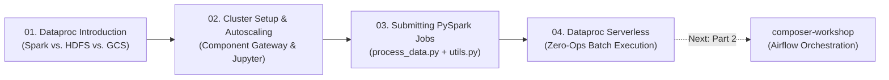

# Google Cloud Dataproc & Apache Spark Workshop

> **Part 1 of 3 in the Google Cloud Data Engineering Series**
> * **Part 1 — Compute Layer (This Repo):** [`dataproc-workshop`](https://github.com/EilinLux/dataproc-workshop) *(Developing PySpark ETL jobs & `utils.py` on Dataproc Clusters and Dataproc Serverless)*
> * **Part 2 — Orchestration Layer:** [`composer-workshop`](https://github.com/EilinLux/composer-workshop) *(Scheduling, Deferrable Sensors, BigQuery Quality Gates & Local `DagBag` Testing with Cloud Composer 3)*
> * **Part 3 — Production CI/CD Blueprint:** [`CiCdAirFlowDagTemplate`](https://github.com/EilinLux/CiCdAirFlowDagTemplate) *(Automated Cloud Build CI/CD pipelines for testing & syncing DAGs + `utils.zip` to Cloud Composer)*

---

## What is Google Cloud Dataproc?

When datasets scale to gigabytes or terabytes, single-node Python scripts run out of memory. **Apache Spark** solves this by distributing data transformations across a cluster of worker nodes in memory. However, managing on-premises Hadoop/Spark clusters requires heavy infrastructure administration, capacity planning, and manual patching.

**Google Cloud Dataproc** is Google Cloud's fully managed and highly scalable service for running **Apache Spark**, **Apache Flink**, **Presto**, and 30+ open-source data tools:
* **Cloud-Native Storage Separation**: Instead of storing data on stateful HDFS disks attached to compute nodes, Dataproc reads and writes directly to **Cloud Storage (`gs://`)** and **BigQuery**—allowing clusters to be created on-demand in under 90 seconds and deleted immediately after a job finishes.
* **Flexible Deployment Models**:
  * **Dataproc on Compute Engine**: Full control over master/worker machine types, Component Gateway (JupyterLab & Spark History Server UIs), custom initialization actions, and **Autoscaling Policies**.
  * **Dataproc Serverless for Spark**: Zero cluster management—submit your PySpark script (`gcloud dataproc batches submit pyspark`) and Google automatically provisions, scales, and tears down the underlying Spark executors.


---

## The Workshop Storyline: From Interactive Spark Clusters to Serverless Batch Processing

This workshop guides you through a four-chapter progression building the **Retail Sales PySpark ETL Engine** (`sales_data.csv` $\rightarrow$ **BigQuery** `filtered_sales`) that you will later orchestrate automatically in **[`composer-workshop`](https://github.com/EilinLux/composer-workshop)** and deploy via CI/CD in **[`CiCdAirFlowDagTemplate`](https://github.com/EilinLux/CiCdAirFlowDagTemplate)**:



### Chapter 01 — Understanding Cloud-Native Spark ([`01_dataproc_introduction/`](./01_dataproc_introduction/README.md))
You start in [`01_dataproc_introduction/`](./01_dataproc_introduction/README.md) by exploring why decoupling compute (Dataproc) from storage (**Cloud Storage** & **BigQuery**) transforms distributed data engineering—enabling ephemeral job-scoped clusters instead of expensive 24/7 monolithic clusters.

### Chapter 02 — Provisioning & Managing Dataproc Clusters ([`02_cluster_setup_and_management/`](./02_cluster_setup_and_management/README.md))
Next, in [`02_cluster_setup_and_management/`](./02_cluster_setup_and_management/README.md), you provision a private-IP Dataproc cluster ([`01_create_cluster.sh`](./02_cluster_setup_and_management/scripts/01_create_cluster.sh)) with **Component Gateway** and **Jupyter** enabled, configure **Autoscaling Policies** for secondary/spot workers, and interactively explore `sales_data.csv` inside JupyterLab ([`csv_reader_interactive.ipynb`](./02_cluster_setup_and_management/notebooks/csv_reader_interactive.ipynb)).

### Chapter 03 — Packaging & Submitting Production PySpark Jobs ([`03_submit_pyspark_jobs/`](./03_submit_pyspark_jobs/README.md))
Interactive notebooks are great for exploration, but production pipelines run as modular Python scripts. In [`03_submit_pyspark_jobs/`](./03_submit_pyspark_jobs/README.md), you refactor your notebook logic into a structured driver script ([`process_data.py`](./03_submit_pyspark_jobs/spark_apps/process_data.py)) and a reusable helper module ([`utils.py`](./03_submit_pyspark_jobs/spark_apps/utils.py)), upload them to Cloud Storage, and submit the job to your cluster via `gcloud dataproc jobs submit pyspark --py-files=...` ([`01_package_and_submit_job.sh`](./03_submit_pyspark_jobs/scripts/01_package_and_submit_job.sh)). *(This exact `--py-files=utils.zip` pattern is automated by Cloud Build in **[`CiCdAirFlowDagTemplate`](https://github.com/EilinLux/CiCdAirFlowDagTemplate)**!)*

### Chapter 04 — Going Serverless with Dataproc Batches ([`04_dataproc_serverless/`](./04_dataproc_serverless/README.md))
Finally, why manage cluster VMs at all when running daily batch ETL? In [`04_dataproc_serverless/`](./04_dataproc_serverless/README.md), you transition to **Dataproc Serverless for Spark** ([`serverless_bq_etl.py`](./04_dataproc_serverless/spark_apps/serverless_bq_etl.py) & [`01_submit_serverless_batch.sh`](./04_dataproc_serverless/scripts/01_submit_serverless_batch.sh))—reading directly from BigQuery (`sales_data`), aggregating daily product revenue without provisioning a cluster, and setting the stage for **Part 2 ([`composer-workshop`](https://github.com/EilinLux/composer-workshop))**, where Cloud Composer schedules this exact batch job daily via `DataprocCreateBatchOperator`.

---

## Repository Structure (Organized by Chapter `01`–`04`)

```text
dataproc-workshop/
├── .env.example                                      # Template with example GCP, Dataproc & BigQuery variables
├── .env                                              # Local environment variables (git-ignored)
├── pyproject.toml                                    # Python dependencies managed with uv
├── README.md                                         # Main workshop storyline, index & quick-start guide
├── artifacts/                                        # Architecture diagrams & UI screenshots extracted from notebooks
│   ├── 01_dataproc_architecture_overview.png
│   ├── 04_dataproc_serverless_architecture.png
│   └── 04_dataproc_serverless_batches_ui.png
│
├── 01_dataproc_introduction/                         # Chapter 01: Cloud-Native Spark & Dataproc Fundamentals
│   ├── README.md
│   └── 01_dataproc_introduction.ipynb
│
├── 02_cluster_setup_and_management/                  # Chapter 02: Cluster Provisioning, Component Gateway & Autoscaling
│   ├── README.md
│   ├── 02_cluster_setup_and_management.ipynb
│   ├── data/
│   │   └── sales_data.csv
│   ├── notebooks/
│   │   └── csv_reader_interactive.ipynb
│   └── scripts/
│       ├── 01_create_cluster.sh
│       └── 02_delete_cluster.sh
│
├── 03_submit_pyspark_jobs/                           # Chapter 03: Modular PySpark Jobs (process_data.py + utils.py)
│   ├── README.md
│   ├── 03_submit_pyspark_jobs.ipynb
│   ├── data/
│   │   └── sales_data.csv
│   ├── spark_apps/
│   │   ├── process_data.py
│   │   └── utils.py
│   └── scripts/
│       └── 01_package_and_submit_job.sh
│
└── 04_dataproc_serverless/                           # Chapter 04: Dataproc Serverless for Spark (BigQuery ETL)
    ├── README.md
    ├── 04_dataproc_serverless.ipynb
    ├── spark_apps/
    │   └── serverless_bq_etl.py
    └── scripts/
        └── 01_submit_serverless_batch.sh
```

---

## Quick Start

```bash
# 0. Authenticate and configure your .env file
gcloud auth login
cp .env.example .env

# Chapter 02: Create a Dataproc Cluster with Jupyter Component Gateway
bash 02_cluster_setup_and_management/scripts/01_create_cluster.sh

# Chapter 03: Upload sales_data.csv, utils.py, and submit process_data.py to the cluster
bash 03_submit_pyspark_jobs/scripts/01_package_and_submit_job.sh

# Chapter 04: Run the BigQuery ETL job on Dataproc Serverless (no cluster needed!)
bash 04_dataproc_serverless/scripts/01_submit_serverless_batch.sh

# Cleanup: Delete the Dataproc cluster when done
bash 02_cluster_setup_and_management/scripts/02_delete_cluster.sh
```
